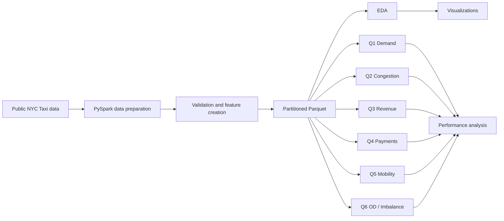
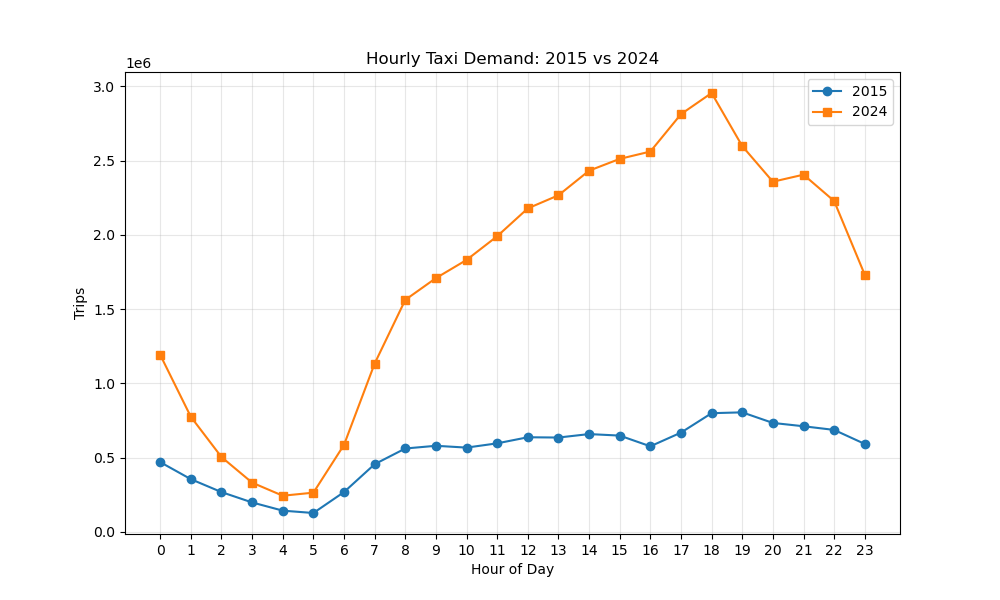
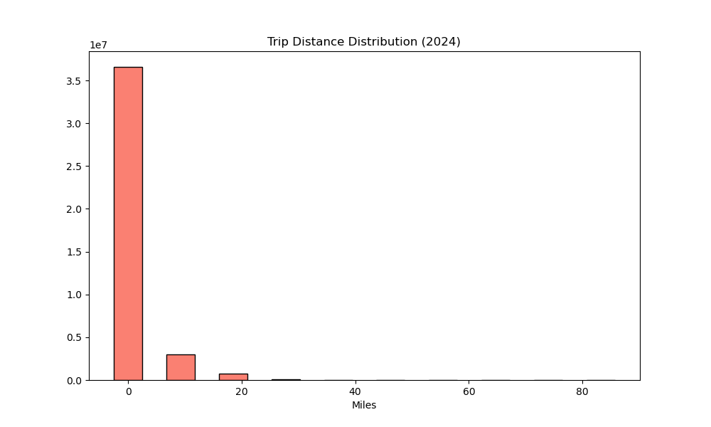
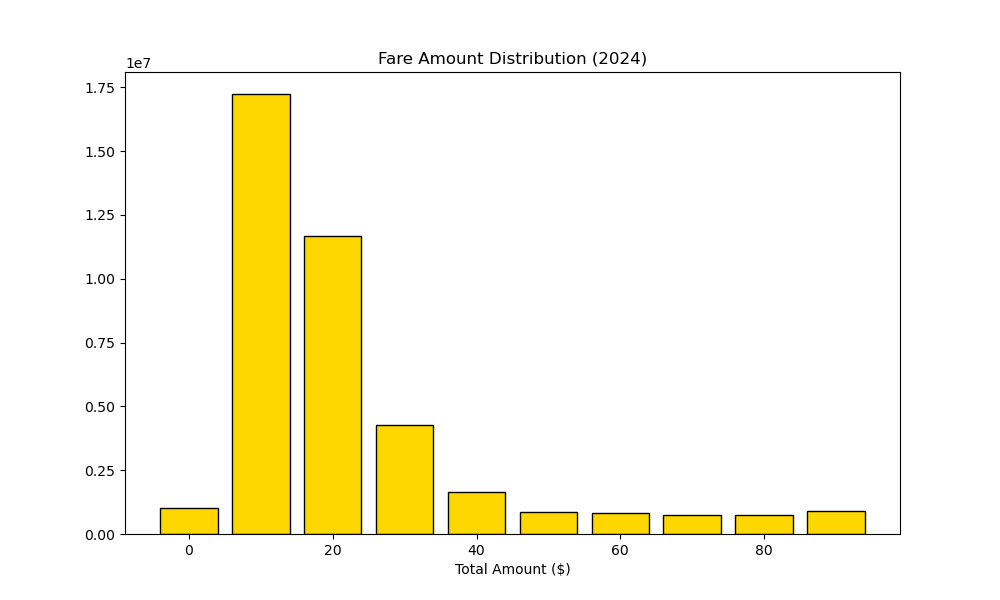
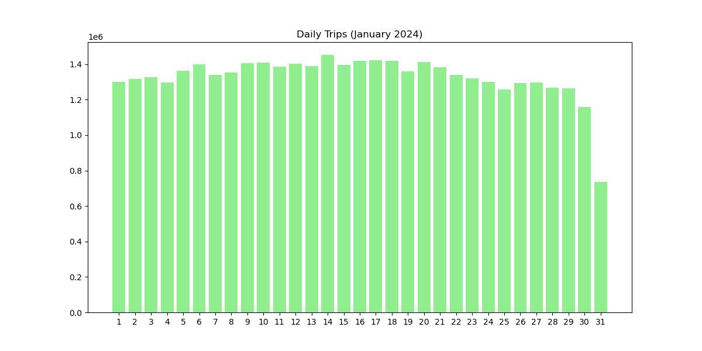
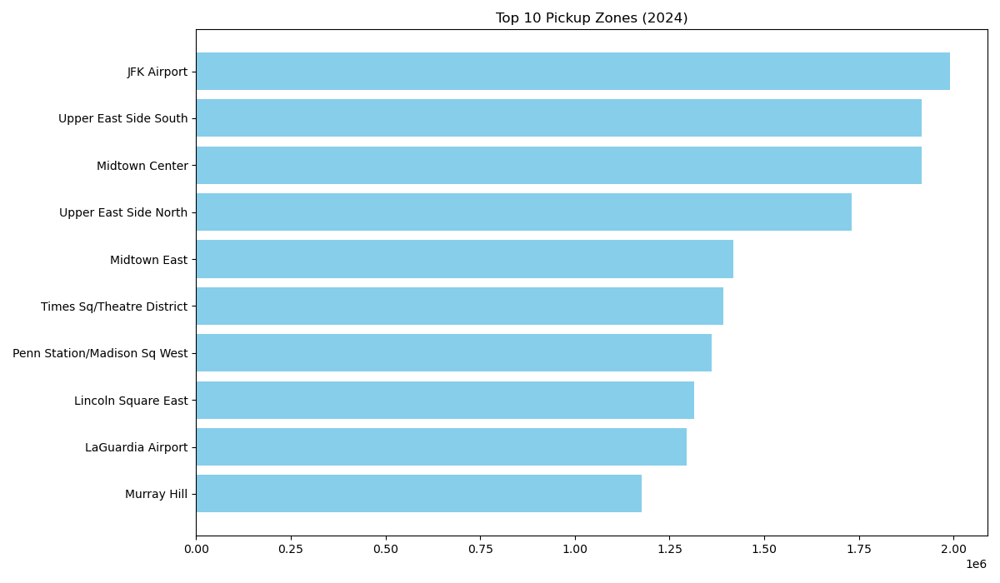
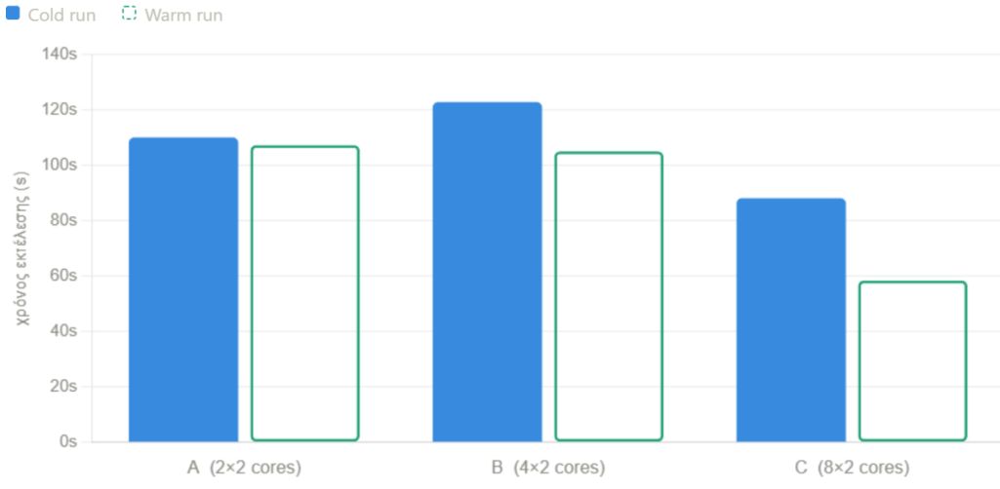

# NYC Taxi Big Data Analytics


A cloud-based big data analytics project built around large-scale **NYC Yellow Taxi** trip records.

The project uses **Apache Spark / PySpark** to build a complete analytical workflow covering data preparation, exploratory data analysis, distributed aggregations, geospatial analysis, revenue and payment analysis, mobility flows, Spark SQL, RDDs, DataFrames, storage-format comparisons, query-optimization experiments, join-strategy comparisons, and scalability benchmarking.

Development and execution were performed from an **Ubuntu Linux** environment, while the PySpark workloads were executed remotely in a distributed cloud environment.

Environment-specific input/output locations and analysis parameters are intentionally configurable so the code can be adapted to another Spark setup.

---

## Table of Contents

- [Project Overview](#project-overview)
- [Main Goals](#main-goals)
- [Technology Stack](#technology-stack)
- [Dataset](#dataset)
- [Repository Structure](#repository-structure)
- [End-to-End Workflow](#end-to-end-workflow)
- [Data Preparation](#data-preparation)
- [Exploratory Data Analysis](#exploratory-data-analysis)
- [Detailed Analysis Modules](#detailed-analysis-modules)
- [Plotting Scripts](#plotting-scripts)
- [Included Visualizations](#included-visualizations)
- [Spark Performance Topics Explored](#spark-performance-topics-explored)
- [Key Engineering Takeaways](#key-engineering-takeaways)
- [Configuration](#configuration)
- [Running the Project](#running-the-project)
- [Reproducibility Notes](#reproducibility-notes)
- [Project Limitations](#project-limitations)
- [Author](#author)

---

# Project Overview

The goal of this project is to analyze a large transportation dataset using the tools and execution model of modern distributed data processing.

Rather than treating the NYC Taxi data as a conventional in-memory dataset, the project is structured around **Spark transformations, distributed aggregations, explicit schemas, Parquet storage, query optimization, caching, partitioning, joins, and execution-time comparisons**.

The project combines two complementary perspectives:

1. **Data analytics** — demand, congestion, trip efficiency, revenue, payments, tipping, geographic flows, airports, and pickup/dropoff imbalance.
2. **Distributed-systems analysis** — RDD vs DataFrame vs Spark SQL, CSV vs Parquet, native Spark expressions vs Python UDFs, partition pruning, broadcast joins, sort-merge joins, cold vs warm execution, and executor scaling.

This makes the repository both a large-scale analytics project and a practical Spark performance study.

---

# Main Goals

The project demonstrates how to:

- process large NYC Yellow Taxi datasets with PySpark;
- define explicit schemas for heterogeneous data versions;
- validate timestamps and numerical fields;
- convert raw CSV data into partitioned **Parquet**;
- use temporal partitioning for selective reads;
- perform EDA before specialized queries;
- compare **RDD**, **DataFrame**, and **Spark SQL** implementations;
- compare **CSV and Parquet** execution;
- compare native Spark expressions with **Python UDFs**;
- analyze taxi demand across time;
- derive duration, speed, direct geographical distance, and detour metrics;
- analyze revenue by zone and distance category;
- study payment methods and tipping behavior;
- map pickup/dropoff IDs to boroughs and taxi zones;
- identify borough-to-borough and airport-related mobility flows;
- compare Spark join strategies;
- measure pickup/dropoff imbalance;
- study origin-destination changes across different portions of the data;
- benchmark Spark jobs under multiple execution configurations;
- distinguish cold and warm execution;
- visualize compact analytical outputs locally.

---

# Technology Stack

- **Python**
- **PySpark**
- **Apache Spark**
- **Spark SQL**
- **Spark RDD API**
- **Spark DataFrame API**
- **Parquet**
- **CSV**
- **Matplotlib**
- **pandas**
- **NumPy**
- **Seaborn**
- **Ubuntu Linux**

The analytical jobs were launched remotely from a Linux-based working environment.

# Dataset

The project uses public **NYC Yellow Taxi trip data** together with the NYC taxi-zone lookup.

## 2015 Yellow Taxi data

The 2015 schema includes fields such as:

- pickup/dropoff timestamps;
- passenger count;
- trip distance;
- pickup longitude/latitude;
- dropoff longitude/latitude;
- payment type;
- fare amount;
- tip amount;
- tolls;
- total amount.

The coordinate fields make the 2015 data useful for direct geographical-distance estimation, speed calculations, detour analysis, and congestion-oriented metrics.

## 2024 Yellow Taxi data

The 2024 schema includes fields such as:

- pickup/dropoff timestamps;
- passenger count;
- trip distance;
- pickup location ID;
- dropoff location ID;
- payment type;
- fare amount;
- tip amount;
- tolls;
- congestion surcharge;
- airport fee;
- total amount.

The location IDs support zone-level analysis, borough mapping, airport-flow analysis, revenue aggregation, and pickup/dropoff imbalance analysis.

## Taxi-zone lookup

The lookup dataset maps location IDs to:

- borough;
- zone;
- service zone.

The raw datasets are not distributed with this repository.

---

# Repository Structure

```text
NYC-Taxi-Big-Data-Analytics/
│
├── pycodes/
│   ├── data_prep.py
│   ├── eda.py
│   ├── q1.py
│   ├── q2.py
│   ├── q3.py
│   ├── q4.py
│   ├── q5.py
│   ├── q6halves.py
│   └── q6imbalance.py
│
├── plot_scripts/
│   ├── eda_plots.py
│   ├── q3_plots.py
│   ├── q4_plot.py
│   └── q5_plots.py
│
├── plots/
│   ├── daily_trips.png
│   ├── distance_dist.png
│   ├── fare_dist.png
│   ├── hourly_demand.png
│   ├── q6_plot.png
│   └── top_zones.png
│
└── README.md
```

The distributed analytical code is kept separate from the lightweight plotting layer.

---

# End-to-End Workflow



The workflow is:

1. Load the public taxi data.
2. Apply explicit schemas.
3. Validate and clean timestamps.
4. Add useful temporal fields.
5. Write prepared Parquet datasets.
6. Perform exploratory analysis.
7. Run specialized distributed queries.
8. Compare Spark APIs and storage formats.
9. Evaluate optimization choices.
10. Generate selected figures from compact outputs.

---

# Data Preparation

## `pycodes/data_prep.py`

`data_prep.py` converts the raw datasets into a form designed for repeated Spark analytics.

Separate schemas are defined for the 2015 and 2024 data because their columns differ.

For each taxi dataset the script:

- loads CSV using an explicit Spark schema;
- counts raw records;
- checks for null pickup timestamps;
- normalizes the pickup timestamp to `pickup_ts`;
- keeps records belonging to the expected year;
- creates the relevant partition column;
- records the final row count;
- calculates the minimum and maximum timestamp;
- writes the prepared dataset as Parquet.

The partition strategy is:

```text
2015 -> pickup_hour
2024 -> pickup_day
```

This later allows queries to benefit from partition pruning when filters align with those fields.

The preparation stage also records metadata such as raw rows, prepared rows, null timestamps, rejected rows, processing duration, and partition column.

Input and output locations are configuration values and must be set for the environment in which the code is executed.

---

# Exploratory Data Analysis

## `pycodes/eda.py`

The EDA module loads the prepared 2015 and 2024 data plus the taxi-zone lookup.

It performs:

### Descriptive statistics

Summary statistics are calculated for important numerical fields such as trip distance and total amount.

### Missing-value analysis

A reusable function calculates null percentages across all columns.

### Temporal demand

Trip counts are aggregated by:

- pickup hour for 2015;
- pickup hour for 2024;
- pickup day for 2024.

### Distribution analysis

RDD histograms are produced for:

- trip distance;
- total amount.

### Zone lookup validation

The 2024 pickup IDs are joined with the taxi-zone lookup to measure lookup coverage and identify the most active pickup zones.

### Anomaly inspection

The EDA explicitly inspects examples of:

- very large trip distances;
- very long trip durations;
- negative total amounts.

The purpose is to understand data quality before applying analytical filters.

---

# Detailed Analysis Modules

# Q1 — Taxi Demand Analysis

## `pycodes/q1.py`

`q1.py` studies 2024 taxi demand while comparing multiple Spark programming interfaces.

It creates features such as:

- pickup/dropoff timestamps;
- pickup hour;
- pickup date;
- day of week;
- weekday name;
- weekend indicator;
- trip duration;
- time-of-day band.

Time bands are represented as:

```text
Night
Morning
Afternoon
Evening
Late
```

A configurable analysis window is applied before aggregation.

### RDD implementation

The RDD branch reads CSV and uses:

- `filter`;
- `map`;
- `reduceByKey`;
- sorting;
- top-K extraction.

Demand is aggregated by `(pickup_date, pickup_hour)` with trip count and total revenue.

### DataFrame implementation

The DataFrame branch calculates:

- trip count;
- unique pickup zones;
- average passenger count;
- average duration;
- average distance;
- average total amount;
- total revenue;
- trip share inside the configured window.

It also creates summaries by time band and day of week.

### Spark SQL implementation

The same structured demand analysis is expressed through Spark SQL using a temporary view.

### CSV vs Parquet

The script benchmarks equivalent demand aggregation against CSV and Parquet inputs.

This demonstrates why Parquet is typically preferable for repeated Spark analytics: typed columnar storage reduces parsing overhead and integrates well with Spark's query engine and partition pruning.

---

# Q2 — Congestion and Trip-Efficiency Analysis

## `pycodes/q2.py`

`q2.py` uses 2015 data because that schema includes pickup and dropoff coordinates.

Derived features include:

- trip duration in minutes and hours;
- trip distance in kilometers;
- estimated average speed;
- direct Haversine distance;
- reported-distance minus direct-distance gap;
- detour ratio.

### Haversine experiment

Haversine distance is implemented in two ways:

1. native Spark mathematical expressions;
2. a Python UDF.

This directly demonstrates the difference between optimizer-visible Spark expressions and Python UDF execution.

### Congestion-oriented metric

A practical congestion-candidate indicator is created from low trip speed while excluding very short trips.

It is intended as an analytical indicator rather than a complete traffic model.

### Hourly metrics

By pickup hour the script computes:

- trip count;
- average duration;
- median duration;
- 90th-percentile duration;
- average speed;
- aggregate speed;
- average Haversine distance;
- average distance gap;
- average detour ratio;
- congestion-candidate share.

It also extracts examples of the slowest and fastest trips.

### Performance comparisons

The module compares:

- DataFrame + CSV;
- DataFrame + Parquet;
- DataFrame + Python UDF;
- Spark SQL + Parquet.

The experiment illustrates a common Spark engineering principle: if a transformation can be expressed with native Spark functions, that is generally preferable to an equivalent Python UDF for large-scale workloads.

---

# Q3 — Revenue and Zone Analysis

## `pycodes/q3.py`

`q3.py` focuses on the economic characteristics of 2024 taxi activity.

The trip data is joined with the taxi-zone lookup so that pickup locations can be associated with borough and zone names.

Trips are categorized into distance buckets:

```text
very_short
short
medium
long
```

For each combination of pickup borough, pickup zone, and distance bucket, the script computes:

- number of trips;
- total revenue;
- average revenue per trip;
- revenue per mile;
- revenue per minute;
- average fare amount;
- average tip amount;
- surcharge share.

### Minimum-support filtering

Small groups can produce unstable rankings.

A minimum-support rule is therefore applied before selecting high-ranking zone/distance combinations.

### DataFrame and SQL implementations

The aggregation is implemented through both the DataFrame API and Spark SQL.

### CSV vs Parquet

The DataFrame version is executed on both CSV and Parquet input.

### Partition-pruning ablation

A dedicated ablation compares a Parquet query that can use the partition filter with a version where that pruning opportunity is removed.

The code also prints formatted Spark execution plans using `EXPLAIN`, allowing the physical effect of partition filtering to be inspected.

This module therefore connects business-style revenue analysis with Spark storage and query-planning behavior.

---

# Q4 — Payment Method and Tipping Analysis

## `pycodes/q4.py`

`q4.py` studies payment and tipping patterns in the 2024 taxi data.

After timestamp enrichment and data-quality filtering, the Parquet data is registered as a Spark SQL view.

### Hourly payment summary

Trips are grouped by:

```text
pickup_hour + payment_type
```

The query calculates:

- trip count;
- payment-method share within each hour;
- average fare;
- average total amount;
- average tip amount;
- average tip rate;
- zero-tip share;
- average trip distance;
- average duration.

### Vendor vs payment type

A second aggregation examines vendor/payment combinations using:

- trip count;
- payment share;
- average fare;
- average total;
- average tip;
- tip rate;
- zero-tip share.

### Card vs cash

The module compares card and cash activity by hour, including:

- number of card trips;
- number of cash trips;
- card share;
- average total amount by payment method;
- average fare by payment method;
- recorded card tip rate.

The card/cash analysis is implemented in both Spark SQL and DataFrame form.

### CSV vs Parquet

The hourly payment query is also executed on CSV to provide another storage-format benchmark.


# Q5 — Borough and Airport Mobility Flows

## `pycodes/q5.py`

`q5.py` analyzes city-level mobility flows by joining 2024 trips with the taxi-zone lookup for both pickup and dropoff locations.

For each pickup-borough / dropoff-borough pair, the script calculates:

- number of trips;
- share of analyzed trips;
- total revenue;
- average total amount;
- average trip distance;
- average trip duration;
- share of airport-related trips.

Trips are also marked as airport-related using the available zone and borough metadata. The script then ranks important airport routes and summarizes metrics such as trip count, average airport fee, average total amount, average duration, and average distance.

The same flow problem is implemented through both the **DataFrame API** and **Spark SQL**.

### Join-strategy experiment

A major engineering component compares:

- **Broadcast join**
- **Sort-merge join**

The taxi-zone lookup is small compared with the main trip dataset, making it a natural broadcast candidate. A second run disables automatic broadcasting so that Spark uses an alternative join strategy.

The script records execution time and prints formatted execution plans, making the impact of join selection directly observable.

---

# Q6 — Origin-Destination Scaling Experiment

## `pycodes/q6halves.py`

`q6halves.py` is designed as a Spark scalability experiment using the full 2024 dataset.

The data is split by day-of-month into two groups:

```text
First half  -> pickup_day <= 15
Second half -> pickup_day > 15
```

For each combination of:

```text
pickup location
+ dropoff location
+ pickup hour
```

the script calculates separate metrics for the two halves.

These include:

- trip count;
- average fare;
- average total amount.

Only origin-destination combinations with sufficient activity in both halves are retained.

The two halves are joined and compared through:

- percentage change in trip count;
- percentage change in average fare.

The script identifies OD combinations with the largest increases and decreases in activity.

### Scalability benchmarking

The same workload can be executed repeatedly under different Spark resource configurations.

For each run, the script records execution time together with the executor configuration supplied to Spark. A run label makes it possible to distinguish repeated executions.

This supports comparisons between:

- different executor allocations;
- cold executions;
- warm executions.

The purpose is to study how resource allocation, scheduling, initialization, cached state, data reuse, and shuffle overhead affect observed performance.

---

# Q6 — Pickup/Dropoff Imbalance Analysis

## `pycodes/q6imbalance.py`

`q6imbalance.py` studies whether each taxi zone behaves primarily as a pickup source or as a dropoff destination during the configured analysis window.

Pickup and dropoff activity are aggregated independently by hour and location. The two datasets are then combined with a full join.

For each zone/hour combination:

```text
activity = pickups + dropoffs
net_pickups = pickups - dropoffs
```

An imbalance ratio is also calculated:

```text
(pickups - dropoffs) / (pickups + dropoffs)
```

The absolute imbalance ratio measures the strength of the imbalance independently of direction.

### Interpretation

- positive `net_pickups` -> more pickups than dropoffs;
- negative `net_pickups` -> more dropoffs than pickups;
- larger absolute imbalance ratio -> stronger directional imbalance.

### Activity threshold

Low-activity zone/hour combinations are filtered using a configurable minimum-activity threshold so that rankings are not dominated by very small samples.

### Zone enrichment

The imbalance results are joined with the taxi-zone lookup to attach:

- borough;
- zone;
- service zone.

### Outputs

The module identifies:

- zones with the strongest positive net pickups;
- zones with the strongest negative net pickups;
- zones with the highest absolute imbalance ratio;
- hourly summaries of overall imbalance.

The same analytical problem is implemented through both the **DataFrame API** and **Spark SQL**, with SQL using common table expressions and joins.

---

# Plotting Scripts

The distributed Spark jobs are intentionally separated from the plotting layer.

The heavy processing is performed remotely with Spark, while compact aggregated outputs can be visualized with standard Python libraries.

This follows a useful large-scale analytics pattern:

> aggregate the large dataset with Spark first, then visualize only the reduced results.

## `plot_scripts/eda_plots.py`

Creates the general exploratory figures included in this repository:

- hourly demand comparison;
- top pickup zones;
- trip-distance distribution;
- fare/total-amount distribution;
- trip counts by day-of-month.

The plotting script works with aggregated results rather than loading the full taxi dataset into Matplotlib.

## `plot_scripts/q3_plots.py`

Provides a revenue-oriented plotting pipeline for Q3 results.

Its logic:

- reads tabular result data;
- converts revenue columns to numeric form;
- removes invalid or duplicate groups;
- sorts groups by total revenue;
- selects the highest-ranked entries;
- combines pickup-zone and distance-bucket labels;
- produces a revenue bar chart.

The result location and ranking configuration must be supplied before use.

## `plot_scripts/q4_plot.py`

Provides a visualization layer for payment/tipping results.

It is designed to display configured hourly metrics such as:

- card-payment share;
- card tipping rate;
- average total amount by payment method.

The plotting values are supplied separately from the Spark analytical logic.

## `plot_scripts/q5_plots.py`

Provides visualization logic for the geographic mobility analysis, including:

- a borough-to-borough flow heatmap;
- a ranked airport-route chart.

The script is intended to be populated with the corresponding compact Spark outputs.

---

# Included Visualizations

The repository contains a selected set of figures that can be understood independently from remote runtime output.

## Hourly demand — 2015 vs 2024



This figure compares the distribution of taxi activity by hour of day across the 2015 and 2024 data.

It provides a direct view of the daily demand cycle and of the difference in activity scale between the two datasets.

---

## Trip distance distribution



Trip distance is concentrated among relatively short urban journeys, while a smaller long tail contains much larger values.

This is useful when interpreting outliers and designing practical filters for later analyses.

---

## Fare / total amount distribution



The monetary distribution also contains a dense central region and a longer upper tail.

This motivates the use of grouped statistics, thresholds, and robust comparisons rather than relying only on a single global average.

---

## Trip counts by day of month



This figure shows how trip volume varies across day-of-month values in the 2024 data.

---

## Most active pickup zones



The zone-level EDA highlights the concentration of taxi activity in major transportation and high-demand city areas.

The corresponding aggregation is produced by joining pickup location IDs with the taxi-zone lookup.

---

## Spark scaling experiment



This figure summarizes repeated Q6 benchmark runs and distinguishes cold from warm execution under multiple Spark resource configurations.

It represents the systems-performance component of the project: distributed processing performance depends not only on query logic, but also on runtime state, caching, scheduling, data movement, and resource allocation.

---

# Spark Performance Topics Explored

A major goal of the project was to connect analytical questions with Spark's actual execution model.

## RDD vs DataFrame vs Spark SQL

The repository uses all three major Spark programming styles.

### RDD

RDD operations provide explicit low-level transformations such as:

- `map`;
- `filter`;
- `reduceByKey`;
- sorting;
- top-K extraction.

They make the mechanics of distributed transformation visible, but Spark has less structural information available for higher-level query optimization.

### DataFrame

DataFrames provide schemas, typed columns, expressions, aggregations, and structured joins.

They allow Spark's optimizer to reason about the computation and are therefore used throughout most of the project.

### Spark SQL

Spark SQL expresses structured operations declaratively.

Several modules intentionally implement the same or closely related analysis in both DataFrame and SQL form to demonstrate that both interfaces use Spark's structured execution engine.

---

## CSV vs Parquet

Multiple scripts compare raw CSV processing with prepared Parquet input.

CSV is useful as an ingestion format, but it requires text parsing and does not provide the same analytical characteristics as Parquet.

Parquet provides:

- columnar storage;
- typed columns;
- selective column reads;
- compression;
- stronger integration with Spark;
- partition pruning.

The project therefore treats CSV primarily as a source format and Parquet as the preferred representation for repeated analytics.

---

## Partition pruning

The prepared Parquet datasets are partitioned by temporal fields.

When a query filters on the partition column, Spark can avoid reading irrelevant partitions.

`q3.py` explicitly compares an analysis that can use the partition filter with a version where the equivalent pruning opportunity is removed.

This demonstrates that performance depends not only on query code but also on physical data organization.

---

## Built-in Spark expressions vs Python UDFs

`q2.py` implements the Haversine calculation through both native Spark mathematical expressions and a Python UDF.

Native Spark expressions remain visible to Spark's optimizer and execute inside Spark's optimized engine.

A Python UDF introduces a Python execution boundary and additional serialization overhead.

This experiment demonstrates why native Spark functions are generally preferable when they can express the required transformation.

---

## Broadcast join vs sort-merge join

`q5.py` joins a very large taxi relation with a much smaller taxi-zone lookup.

This is a classic use case for broadcasting the small relation.

The script compares the broadcast-oriented execution with a run in which automatic broadcasting is disabled.

The experiment demonstrates why avoiding an unnecessary shuffle can be more important than small application-level code changes.

---

## Caching and warm execution

Some analyses cache DataFrames that are reused by multiple actions.

The Q6 benchmark also distinguishes cold from warm executions.

Warm execution can differ because of factors such as:

- initialized executors;
- cached data;
- JVM warm-up;
- reused runtime state;
- reduced startup overhead.

Performance measurements are therefore more informative when run state is considered explicitly.

---

## Executor scaling

The Q6 experiment repeats the same workload under multiple resource allocations.

This tests an important distributed-computing assumption:

> more executors do not automatically produce linear speedup.

Potential limiting factors include:

- task scheduling;
- shuffle overhead;
- data movement;
- partition count;
- startup cost;
- serialization;
- stages with limited parallelism.

---

# Key Engineering Takeaways

### 1. Storage format is part of query design

A Spark job cannot be evaluated independently from the format and physical organization of the underlying data. Repeated analytical workloads benefit from typed, columnar, partitioned storage.

### 2. Structured APIs expose optimization opportunities

DataFrame and SQL operations provide Spark with information that can be used for logical and physical query planning.

### 3. Python UDFs should be used selectively

UDFs are useful when required logic cannot be expressed with Spark functions, but native expressions are preferable when equivalent functionality exists.

### 4. Small lookup relations can change the optimal join plan

The taxi-zone lookup is small compared with the trip data, making broadcast joins an important optimization to test.

### 5. Data organization can reduce work before computation starts

Partition pruning demonstrates how storage layout can reduce the volume of data scanned by a query.

### 6. Benchmarking must consider runtime state

Cold and warm Spark jobs can have materially different execution characteristics.

### 7. Scaling is workload-dependent

Distributed systems have overhead, and the largest resource allocation is not automatically the most efficient one.

### 8. Heavy processing and visualization should be separated

Spark performs the large aggregations. Matplotlib, pandas, and NumPy are used only after the result size has been reduced.

---

# Configuration

The repository does not assume fixed environment-specific input or output locations.

Before running the scripts, configure the required:

- source-data locations;
- output location;
- analysis hour window where applicable;
- day selection where applicable;
- top-K value where applicable;
- other analysis-specific placeholders.

The current configuration values should be treated as templates rather than as a ready-to-run experiment.

---

# Running the Project

## 1. Clone the repository

```bash
git clone https://github.com/IliasSkar/NYC-Taxi-Big-Data-Analytics.git
cd NYC-Taxi-Big-Data-Analytics
```

## 2. Install visualization dependencies

```bash
pip install pandas numpy matplotlib seaborn
```

The distributed analytical jobs additionally require a working Apache Spark / PySpark installation.

For a Python-managed environment:

```bash
pip install pyspark
```

A compatible Java runtime is also required by Apache Spark.

---

## 3. Prepare the data

Configure the input/output variables in:

```text
pycodes/data_prep.py
```

Then submit the preparation job:

```bash
spark-submit pycodes/data_prep.py
```

The resulting prepared Parquet datasets can then be supplied to the remaining modules.

---

## 4. Run EDA

```bash
spark-submit pycodes/eda.py \
  --data2015 <PARQUET_2015> \
  --data2024 <PARQUET_2024> \
  --lookup <ZONE_LOOKUP> \
  --output <OUTPUT_LOCATION>
```

## 5. Run Q1

```bash
spark-submit pycodes/q1.py \
  --parquet2024 <PARQUET_2024> \
  --csv2024 <CSV_2024> \
  --output <OUTPUT_LOCATION>
```

## 6. Run Q2

```bash
spark-submit pycodes/q2.py \
  --parquet2015 <PARQUET_2015> \
  --csv2015 <CSV_2015> \
  --output <OUTPUT_LOCATION>
```

## 7. Run Q3

```bash
spark-submit pycodes/q3.py \
  --parquet2024 <PARQUET_2024> \
  --csv2024 <CSV_2024> \
  --zone_lookup <ZONE_LOOKUP> \
  --output <OUTPUT_LOCATION>
```

## 8. Run Q4

```bash
spark-submit pycodes/q4.py \
  --parquet2024 <PARQUET_2024> \
  --csv2024 <CSV_2024> \
  --output <OUTPUT_LOCATION>
```

## 9. Run Q5

```bash
spark-submit pycodes/q5.py \
  --parquet2024 <PARQUET_2024> \
  --zones <ZONE_LOOKUP> \
  --output <OUTPUT_LOCATION>
```

## 10. Run the Q6 origin-destination benchmark

```bash
spark-submit pycodes/q6halves.py \
  --parquet2024 <PARQUET_2024> \
  --output <OUTPUT_LOCATION> \
  --run-label <RUN_LABEL>
```

Repeat the same workload under different Spark resource configurations when performing a scaling comparison.

## 11. Run the Q6 imbalance analysis

```bash
spark-submit pycodes/q6imbalance.py \
  --parquet2024 <PARQUET_2024> \
  --zones <ZONE_LOOKUP> \
  --output <OUTPUT_LOCATION>
```

---

# Running the Plotting Scripts

The plotting scripts are intended to run after the distributed analyses have produced compact result data.

```bash
python plot_scripts/eda_plots.py
```

Result-specific scripts may require their input values or output locations to be configured first:

```bash
python plot_scripts/q3_plots.py
python plot_scripts/q4_plot.py
python plot_scripts/q5_plots.py
```

Not every configuration-dependent plot is bundled with the repository. The selected general figures are stored in `plots/`.

---

# Reproducibility Notes

Spark execution times are highly dependent on runtime conditions.

Exact timings can vary with:

- Spark version;
- Java version;
- executor count;
- executor cores;
- executor memory;
- partition count;
- storage throughput;
- caching state;
- cold vs warm execution;
- shuffle behavior;
- CPU and memory availability;
- concurrent workloads.

For meaningful benchmarking:

1. use the same input data for compared implementations;
2. keep analytical filters and configuration consistent;
3. record the Spark resource configuration;
4. distinguish cold from warm runs;
5. repeat measurements when possible;
6. compare execution plans as well as wall-clock time;
7. avoid drawing conclusions from one isolated run.

---

# Project Limitations

This repository is an analytical and engineering project rather than a production taxi-demand platform.

Important limitations include:

- congestion is represented through analytical indicators rather than a validated traffic model;
- Haversine distance represents straight-line geographical distance rather than road-network distance;
- route-detour metrics depend on the quality of reported trip-distance and coordinate fields;
- airport detection depends on the available taxi-zone metadata;
- runtime comparisons are environment-dependent;
- some analysis windows and ranking parameters require configuration before execution;
- the repository does not distribute the raw NYC Taxi datasets;
- only selected visual outputs are included.

Despite these limitations, the project provides an end-to-end demonstration of distributed data preparation, Spark analytics, query optimization, performance analysis, and visualization on a large real-world transportation dataset.

---
# License

This project is licensed under the **MIT License**.

See the [`LICENSE`](LICENSE) file for full details.

---
# `.gitignore`

The repository includes a `.gitignore` file to prevent local, generated, or environment-specific files from being committed.

It excludes, among others:

- Python cache files and virtual environments,
- IDE configuration files,
- environment and secret files,
- local datasets such as CSV and Parquet files,
- Spark-generated files,
- logs and temporary outputs,
- local result folders,
- operating-system metadata,
- archive files.

This keeps the repository focused on source code, selected plots, and documentation.

---
# Author

**IliasSkar**
